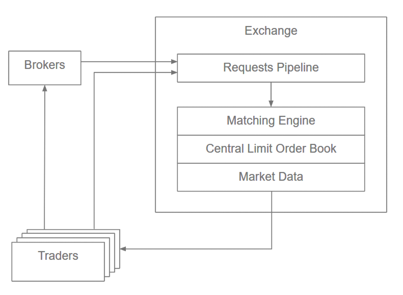
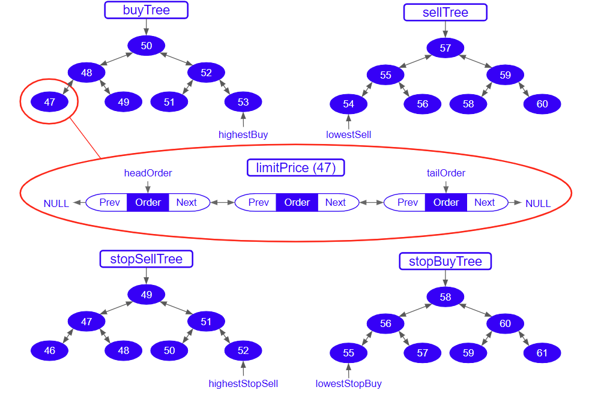

# Simulation Core

## Limit Order Book (LOB)

### Overview

Acts as the virtual stock exchange and serves as the single source of truth for the simulated market state.
It is built in python and should be able to handle +1,000,000 TPS (trades per second).

### Background information

The matching is a core part of any electronic exchange. Its where buyers and traders meet and executes trades by matching order prices. The matching engine maintains the limit order book and contains all oders that have yet to be matched. Since the matching engine is the sole executor of trades, we need to make a fast matching engine to avoid latency and delay. 

### Supported Order Types

The order types that will be covered by the LOB is as follow,

| Type | Behavior on Submit | Modify / Cancel |
| --- | --- | --- |
| **MarketOrder** | Executes immediately at the best available market price. Unfilled remainder is canceled. | **No** |
| **LimitOrder** | Rests at its limit price without instant trades. The engine rejects crossing submissions (use `MarketLimitOrder` for crossing). | **Yes** (while resting) |
| **MarketLimitOrder** | Limit order that crosses the book: executes in a taker phase first, then any remainder rests at the limit price. | **Yes** (resting remainder) |
| **StopOrder** | Remains dormant until the market hits the trigger price, then converts into a **MarketOrder**. | **Yes** (pre-trigger) |
| **StopLimitOrder** | Remains dormant until the market hits the trigger price, then converts into a **LimitOrder** (allowed to cross). | **Yes** (pre-trigger) |

### Idea 

Following implementations of actual LOB and matching engines, we will use a FIFO and Price-Time priority to determine the execution order of entries in the LOB. 

* **Data Structure:** Requests are organized in balanced binary trees (one for **Buy** orders and one for **Sell** orders).
* **AVL Trees:** Each binary tree is implemented as an **AVL tree**, where each node represents a specific **price level** to keep the tree balanced and ensure $O(\log M)$ search/insertion times.
* **Node:** Each node (price level) is a doubly linked list inserted based on order submission time (FIFO).

### Architecture

#### File Structure
app/core/                          # simulation core
├── lob/                           # Limit Order Book engine (package)
│   ├── __init__.py                #   public API re-exports (single import point)
│   ├── contracts.py               #   enums (Side/OrderType/OrderStatus), errors, tick math
│   ├── orders.py                  #   the five public order types (submission model)
│   ├── events.py                  #   engine events (Accepted/Trade/Rejected/...)
│   ├── nodes.py                   #   internal Order node + Limit price level (C++ structs)
│   ├── book.py                    #   Book: price ladders, sentinels, sweeps, stops, invariants
│   ├── engine.py                  #   LimitOrderBook facade: lifecycle, records, triggers
│   └── registry.py                #   SymbolRegistry: one single-writer book per ticker
├── aggregator/
│   └── metrics.py                 # Market Metrics Aggregator (in progress)
├── README.md                      # architecture doc (this file)
└── assets/                        # diagrams

#### Historical Orders and Caching

### Time Complexity

- Add Order – O(log M) for the first order at a limit, O(1) for all others, where M is the number of price Limits (generally << N the number of orders).
- Cancel Order – O(1)
- Modify Order – O(1)
- Execute – O(1)
- GetVolumeAtLimit – O(1)
- GetBestBid/Offer – O(1)

### Constraints
- Order shares > 0
- PPS > 0
- Order Ids are unique

### References
https://github.com/brprojects/Limit-Order-Book/tree/main

---

## Metrics Aggregator
